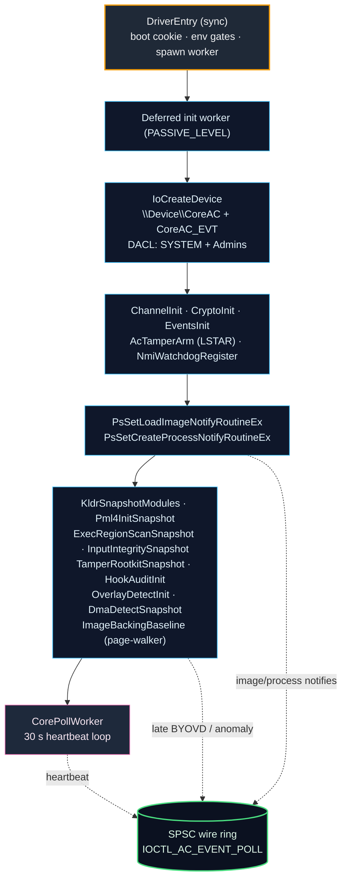
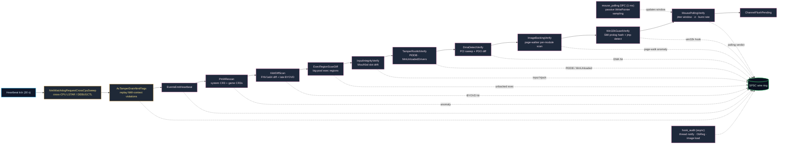
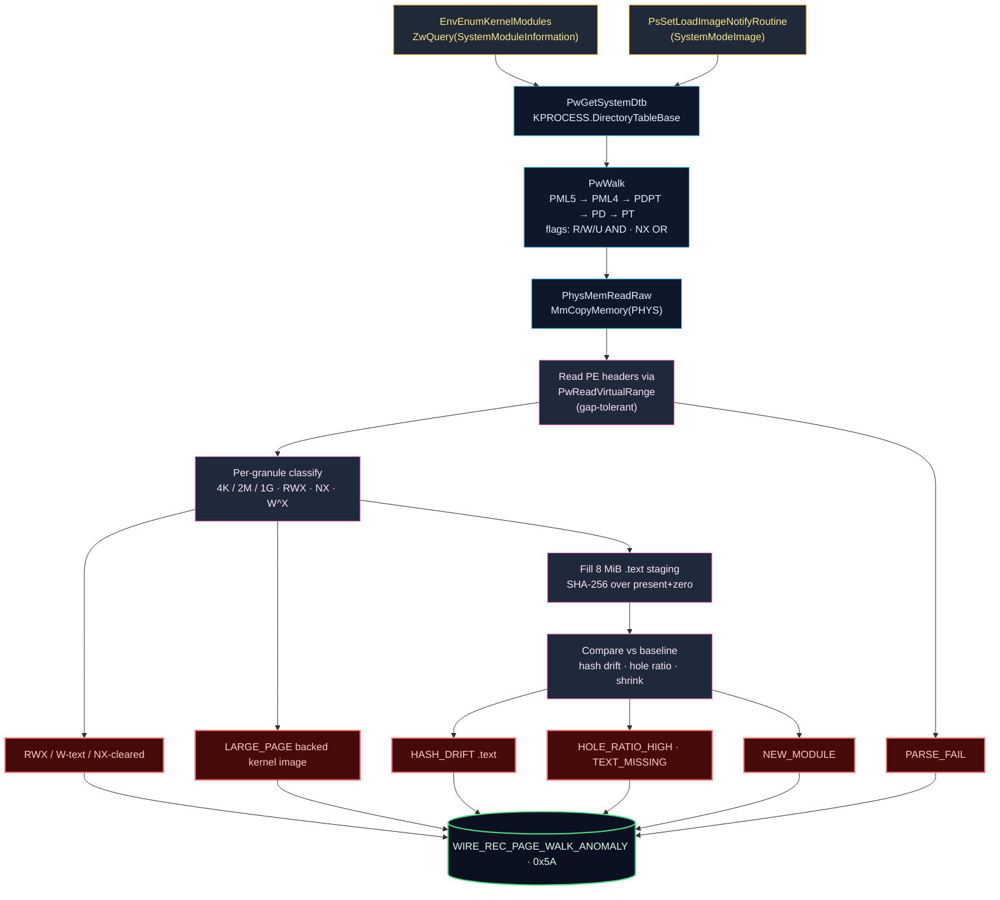

# Core_ac — Kernel Anti-Cheat

A Windows x64 kernel-mode anti-cheat driver designed for competitive multiplayer titles. Core_ac is a self-contained reference implementation focused on clean modular architecture, verifiable detection techniques, and a hardened user-mode channel protected by per-session AES-GCM sealing.

> **Status:** Reference implementation. Everything in this tree compiles against the Windows WDK and the Visual Studio 2022 kernel-mode toolset. There are no stubs, no VM shims, and no vendored third-party crypto — all cryptography is delegated to the Windows CNG (`BCrypt*`) kernel surface.

---

## 1. Why Core_ac

Modern anti-cheats are judged by three qualities:

1. **Correctness in the kernel.** Allocations are NX-tagged, callbacks are symmetrical, every acquired resource has a clear owner, and dispatch respects IRQL.
2. **Resistance to tampering.** Boot-time secrets live as XOR-pairs, the LSTAR MSR is tracked across every IOCTL *and* from NMI context, and the control device is DACL-locked to SYSTEM + Administrators only.
3. **Observability without blind spots.** Image loads, process creation, PML4 drift, BYOVD loads, and HWID state all surface as typed wire records on a lock-free SPSC ring that user mode drains via `IOCTL_AC_EVENT_POLL`.

Core_ac is structured so each of those three qualities can be audited independently: no module reaches into another's private state, every subsystem exposes a short `*_Init` / `*_Shutdown` lifetime, and the only global state lives in a single `CORE_AC_GLOBAL`.

---

## 2. Architecture at a glance



Only `DriverEntry` runs synchronously. Device registration, callback installation, and detection pipelines boot from a worker so static analysis of the entry point never reveals the full surface. Every detection module ultimately pushes typed records into the SPSC ring, which user mode drains through `IOCTL_AC_EVENT_POLL`.

---

## 3. Module map

| File | Role |
|---|---|
| `driver_entry.c` | DriverEntry, deferred init worker, DACL hardening, DriverUnload, callback plumbing |
| `anti_tamper.{c,h}` | Boot cookie XOR-pair, LSTAR / DEBUGCTL / stack-cookie checks |
| `nmi_watchdog.{c,h}` | NMI callback + cross-CPU sweep via `HalSendNMI` |
| `env_checks.{c,h}` | Safe boot, hypervisor cpuid gate, kernel-debugger probe, module enumeration |
| `ioctl.{c,h}` | Major function dispatch and IOCTL handlers |
| `channels.{c,h}` | SPSC event ring, per-kind blob slots with case-insensitive wide-char lookup |
| `wire_records.{c,h}` | Typed record layouts (heartbeat, process attach, image load, BYOVD, PML4 anomaly, tamper, HWID, unbacked exec, input hijack, PiDDB/MmUnloaded tamper, signature reject, hook/handle audit, overlay detect) |
| `events.{c,h}` | Record producers for the detection pipelines |
| `crypto.{c,h}` | CNG-backed SHA-256, random, AES-GCM session sealing, ECDH-P256 handshake |
| `byovd_scanner.{c,h}` | Baked substring blacklist of 60+ vulnerable drivers (BYOVD) |
| `driver_ts_blacklist.{c,h}` | PE `TimeDateStamp` denylist |
| `kldr.{c,h}` | Kernel module inventory, FNV1a64 fingerprints, diff rescan |
| `pml4_scan.{c,h}` | Physical PML4 walker via `MmCopyMemory(MM_COPY_MEMORY_PHYSICAL)`; snapshots system CR3 and up to 8 user-registered game CR3s |
| `physmem.{c,h}` | Physical-memory read helper |
| `smbios.{c,h}` | SMBIOS table parse (BIOS, system, baseboard, memory) via `ZwQuerySystemInformation(RSMB)` |
| `hwid.{c,h}` | SMBIOS roll-up, ACPI enumeration, composite SHA-256 digest |
| `game_integrity.{c,h}` | Per-image load PE validation, threads `CiValidateFileObject` when available, binds PID to PML4 watcher on matched process load |
| `exec_region_scan.{c,h}` | `SystemBigPoolInformation` sweep; emits `UNBACKED_EXEC` for non-paged allocations ≥ 256 B that fall outside any known kernel module |
| `input_integrity.{c,h}` | Snapshots `MouClass`/`KbdClass` service-callback slots inside the upper filter's `DeviceExtension`; emits `INPUT_HIJACK` on drift |
| `tamper_rootkit.{c,h}` | Pattern-resolves `PiDDBCacheTable` and `MmUnloadedDrivers`, snapshots counts + FNV, emits `PIDDB_TAMPER` / `MMUNLOADED_TAMPER` on silent mutation |
| `hook_audit.{c,h}` | `PsSetCreateThreadNotifyRoutine` + `ObRegisterCallbacks` + user-image heuristic over protected game PIDs; emits `HOOK_AUDIT` / `HANDLE_AUDIT` for the `SetWindowsHookEx` / `SetProp[2]` abuse surface Vanguard captures through SSDT detours |
| `overlay_detect.{c,h}` | Overlay detector: parses window extended-style flags pushed from the companion, walks the owner's parent chain (built from `PsSetCreateProcessNotifyRoutineEx`), checks for a whitelisted shell ancestor, matches cheat-style class names, and sets bits on a module-wide flag variable; emits `OVERLAY_DETECT` |
| `dma_detect.{c,h}` | DMA-card detector: enumerates PCI config space via `HalGetBusDataByOffset`, fingerprints known DMA FPGA VID:DID (pcileech-fpga / Screamer / LeetDMA / Captain-DMA / ZDMA), walks the PCIe extended capability chain for a zeroed Device Serial Number, cross-checks against the `\Driver\pci` PDO list for hidden devices, and diffs each heartbeat scan against a boot baseline for hot-plug / header-type mutation; emits `DMA_HIT` |
| `page_walker.{c,h}` | Read-only x64 page-table walker (PML5/PML4/PDPT/PD/PT) via `MmCopyMemory(MM_COPY_MEMORY_PHYSICAL)`; detects LA57, MAXPHYADDR; resolves VA→PA with accumulated R/W/U/NX flags; handles 4K / 2M / 1G leaves; exposes `PwReadVirtualRange` for gap-tolerant VA reads |
| `image_backing.{c,h}` | Image-backing integrity scanner driven by `page_walker`: per-module PE parse through physical reads, SHA-256 of the first executable section, per-leaf classification (RWX, writable .text, NX cleared, large-page backing), hole-ratio and hash-drift diff vs. the boot baseline; emits `PAGE_WALK_ANOMALY` |
| `win32k_guard.{c,h}` | Session-space inline-hook detector for `win32kbase!SynthesizeMouseInput`: attaches to a GUI session process (winlogon / explorer) so win32k is addressable, pattern-locates the function, hashes a 256-byte sample via `page_walker`, diffs each heartbeat; also flags a jmp-shaped prologue (`E9 ??`, `FF 25`, `mov rax, imm64; jmp rax`); emits `WIN32K_HOOK` |
| `mouse_polling.{c,h}` | Passive polling-statistics detector inspired by Vanguard's anti-Macku / anti-KMBox check: a 1 ms `KTIMER` + DPC samples each `MouClass` device's `DeviceExtension.WritePointer` without hooking anything, derives per-packet Δt, rolls a 100-sample window, and computes σ, burst rate (Δt < 0.5 ms), instant Hz, and max-packets-per-tick; emits `MOUSE_POLLING` with verdict `WAITING` / `NATURAL` / `SUSPICIOUS` / `INJECTION` |
| `usermod.{c,h}` | User-mode module walker (PEB `InLoadOrderModuleList`) |
| `strings.{c,h}` | Kernel-safe string primitives, FNV1a 32/64, memmem, hex formatter |
| `core.h` | Shared types, pool tags, device names, status codes |
| `imports.h` | NT/ZW signatures not exposed by the WDK headers |

---

## 4. Boot flow

```
DriverEntry
 ├─ AcTamperInitBootCookie()
 │    perf = KeQueryPerformanceCounter()
 │    tsc  = __rdtsc()
 │    seed = perf ^ tsc ^ (pid << 17)
 │    BootCookie[0] = seed
 │    BootCookie[1] = ~seed          // XOR pair: a ^ b == -1
 │
 ├─ EnvRunBootGates()
 │    ├─ InitSafeBootMode  → fail if non-zero
 │    └─ ZwQuerySystemInformation(SystemKernelDebuggerInformation)
 │       → fail if KernelDebuggerEnabled && !KernelDebuggerNotPresent
 │
 └─ ExQueueWorkItem(CoreDeferredInit, CriticalWorkQueue)
        ├─ CoreCreateDevices()                 \Device\CoreAC + \Device\CoreAC_EVT
        ├─ CoreApplyDeviceDacl()               SYSTEM + Admins GENERIC_ALL, deny-all otherwise
        ├─ ChannelInit() CryptoInit() EventsInit()
        ├─ AcTamperArm()                       snapshot LSTAR (0xC0000082)
        ├─ NmiWatchdogRegister()               KeRegisterNmiCallback
        ├─ PsSetLoadImageNotifyRoutine         image-load pipeline
        ├─ PsSetCreateProcessNotifyRoutineEx   process-create pipeline
        ├─ KldrSnapshotModules()               full kernel-module inventory + PE timestamps
        ├─ Pml4InitSnapshot()                  copy current CR3 PML4 via physical read
        ├─ ByovdScannerInit()                  prime FNV1a64 of blacklist
        ├─ GameIntegrityInit()                 resolve CiValidateFileObject if present
        ├─ HwidCollectBoot()                   SMBIOS fanout → wire record HWID_HELLO
        ├─ ExecRegionScanInit + Snapshot       baseline of non-paged big pool outside known modules
        ├─ InputIntegrityInit + Snapshot       MouClass / KbdClass service-callback slot snapshot
        ├─ TamperRootkitInit + Snapshot        resolve + hash PiDDBCacheTable, MmUnloadedDrivers
        ├─ HookAuditInit + RegisterCallbacks   PsSetCreateThreadNotifyRoutine + ObRegisterCallbacks
        ├─ OverlayDetectInit()                 pid→parent map + overlay flag variable
        ├─ DmaDetectInit + Snapshot            PCI config-space + \Driver\pci PDO baseline
        ├─ ImageBackingInit + Baseline         page-walker baseline: PE hash + per-leaf flags
        ├─ Win32kGuardInit + Baseline          win32kbase!SynthesizeMouseInput prolog hash
        ├─ MousePollingInit + DiscoverDevices  mouclass write-pointer snapshot, start 1 ms DPC
        └─ CoreStartWorker()                   30 s heartbeat loop
```

The heartbeat loop then fans out every 30 s into one documented producer per detector, each of which writes typed records into the SPSC ring:



---

## 5. Device + DACL hardening

| Object | Path | Access |
|---|---|---|
| Control device | `\Device\CoreAC` (`\??\CoreAC`) | SYSTEM, Administrators — everyone else denied |
| Event device   | `\Device\CoreAC_EVT`              | SYSTEM, Administrators — everyone else denied |

The DACL is applied with `ObSetSecurityObjectByPointer` after device creation. Both ACEs are `GENERIC_ALL`; everyone else inherits the empty DACL and gets no access. Standard anti-cheat practice: user-mode companion runs as a SYSTEM service, nothing else can `CreateFile` on the device.

---

## 6. Anti-tamper

Three complementary checks:

1. **LSTAR (`0xC0000082`).** Snapshotted during `AcTamperArm` into an XOR-pair. On every IOCTL dispatch and every NMI callback the current value is compared to the reference. Mismatch → tamper event is enqueued and the MSR is rewritten to the known-good value.
2. **DEBUGCTL (`0x1D9`).** The LBR bit is checked from NMI context. If userland or a hypervisor flipped it to steal callstacks, we observe it where we can't be masked.
3. **Stack cookie.** A per-boot XOR-pair derived from `__rdtsc`. Mismatch is routed through the tamper event producer.

Boot cookie, LSTAR reference and stack cookie are stored exclusively as XOR-pairs so a lazy scanner looking for the live value by signature finds nothing.

---

## 7. Detection surfaces

### 7.1 BYOVD scanner

Catches vulnerable drivers using two independent signals:

- **Substring match (lowercase case-fold Unicode).** 60+ well-known BYOVD names baked in: `winring0`, `rtcore64`, `mhyprot2`, `dbutil_2_3`, `iqvw64`, `winio`, `phymem`, `atillk64`, `rwdrv`, and so on.
- **PE `TimeDateStamp` denylist.** `driver_ts_blacklist.c` carries timestamps known to belong to signed-but-weaponizable drivers.

Both signals produce `WIRE_REC_BYOVD_HIT` records tagged with `ImageBase`, `ImageSize`, the matched path, and a path FNV1a64.

### 7.2 PML4 physical walker

Reads the current CR3-pointed PML4 page via `MmCopyMemory` with `MM_COPY_MEMORY_PHYSICAL`. This bypasses virtual-address hooks placed by non-root hypervisors or EPT shadows. The initial snapshot is compared against each rescan; drift surfaces as `WIRE_REC_PML4_ANOMALY` records with observed vs. expected entries and the physical base.

### 7.3 HWID collection

Through `ZwQuerySystemInformation(SystemFirmwareTableInformation)` using the `'RSMB'` provider. The parser walks SMBIOS entry types 0, 1, 2, and 17 to extract BIOS vendor, system manufacturer, product, baseboard serial, system UUID, and memory module count. The ACPI enumerator runs best-effort — VBS/HVCI systems may return `STATUS_NOT_IMPLEMENTED`, which the caller tolerates.

A composite digest (SHA-256 over the parsed structure) is cached and emitted as `WIRE_REC_HWID_HELLO`.

### 7.4 Image + process callbacks

- `PsSetLoadImageNotifyRoutineEx` (resolved dynamically through `MmGetSystemRoutineAddress`, falling back to `PsSetLoadImageNotifyRoutine`) demultiplexes into kernel-image path (BYOVD scanner, module inventory diff) and user-image path (`WIRE_REC_IMAGE_LOAD`).
- When `ExtendedInfoPresent` is set and `CiValidateFileObject` resolved, the shim is invoked under `__try/__except`; a failing return produces `WIRE_REC_SIG_REJECT` with the image path, base and NTSTATUS.
- `PsSetCreateProcessNotifyRoutineEx` produces `WIRE_REC_PROCESS_ATTACH` (with parent PID + image path) and `WIRE_REC_PROCESS_EXIT` on teardown; exits also drop the PML4 watcher entry.

### 7.5 Unbacked execution regions

`exec_region_scan.c` drives `ZwQuerySystemInformation(SystemBigPoolInformation)` (class `0x42`). For each non-paged entry ≥ 256 B whose base does not fall inside a module from the boot `KldrSnapshotModules`:

- At boot it is written to the baseline (up to 1024 entries).
- At each heartbeat, anything new relative to that baseline is enqueued as `WIRE_REC_UNBACKED_EXEC` with up to 64 bytes of leading content, the pool tag, and a `Flags` bit set when the tag has non-printable bytes (useful heuristic for tags such as `'llehS'` left by shellcode trampolines).

Capped at 32 hits per pass to prevent telemetry floods.

### 7.6 Input class callback integrity

`input_integrity.c` references `\Driver\MouHID`, `\Driver\KbdHid` and `\Driver\i8042prt`, walks each upper device's `AttachedDevice` chain, and for every paired `\Driver\MouClass` / `\Driver\KbdClass` device scans the upper device's `DeviceExtension`. When it finds a slot whose value equals the class `PDEVICE_OBJECT` and whose next slot points above the class `PDRIVER_OBJECT`, that next slot holds the service callback. The slot address, the current value, **and the owning class driver's `DriverStart`/`DriverSize`** are snapshotted.

Two independent anomalies are emitted:

- **Baseline out-of-range.** The baseline callback pointer must live inside the matching class driver's image (`mouclass.sys` for mouse slots, `kbdclass.sys` for keyboard slots). If an attacker hooks the slot *before* Core_ac loads — modern synthetic-input drivers do this intentionally so drift-only detectors stay silent — the discovered pointer points at the attacker's driver instead. We raise `WIRE_REC_INPUT_HIJACK` + `WIRE_REC_TAMPER(AC_TAMPER_REASON_INPUT)` immediately at `InputIntegritySnapshot` time with observed == expected (the drift is zero, but the geometry is already wrong).
- **Runtime drift.** On every heartbeat the slot is re-read under `__try/__except`; anything that no longer equals the snapshot and no longer lands inside the class driver's range emits the same record pair.

The class-driver-range check is what catches the "interceptor installed before anti-cheat" path; the drift check continues to cover the normal "cheat loaded after" case.

### 7.7 PiDDBCache / MmUnloadedDrivers mutation

`tamper_rootkit.c` pattern-scans `ci.dll:.text` with the 21H1 and 22H2 signatures to resolve `PiDDBCacheTable`, and `ntoskrnl:.text` to resolve `MmUnloadedDrivers`. Snapshot captures:

- `RTL_AVL_TABLE.NumberGenericTableElements` combined with `DeleteCount` as a composite FNV.
- FNV1a64 over the names + unload-time of up to 50 `MmUnloadedDrivers` entries.

On rescan, a drop in the AVL element count, or any FNV mismatch, produces `WIRE_REC_PIDDB_TAMPER` / `WIRE_REC_MMUNLOADED_TAMPER` and routes a `WIRE_REC_TAMPER` with the appropriate reason code. Legitimate growth is folded into the expected state so the detector does not become sticky.

### 7.8 Game-process PML4 drift

When the companion pushes an executable path via `IOCTL_AC_PUSH_PROCESS_PATH`, `game_integrity.c` matches the next user-image load's `FullImageName` against that blob (case-insensitive, tail match on wide chars). On a hit, `Pml4RegisterGameProcessByPid` resolves the target CR3 by attaching with `KeStackAttachProcess` + `__readcr3()` and snapshots its PML4 physical page. The heartbeat rescans each registered CR3 the same way the system CR3 is rescanned and emits `WIRE_REC_PML4_ANOMALY` with the owning physical base.

Up to `PML4_MAX_WATCHED` (8) processes can be registered concurrently. Entries are released on process-exit or driver unload.

### 7.9 Protected-process hook / handle audit

`hook_audit.c` closes the attack surface that Vanguard covers with its native hooks on `NtUserSetWindowsHookEx`, `NtUserSetProp` and `NtUserSetProp2` — all three are the user-mode plumbing for parasite-DLL injection and foreign window-ownership mutation against the game process. Core_ac refuses to install an SSDT or inline detour (section 14 of this document); instead it collects the same audit intent through three documented kernel surfaces and gates every signal on the protected-PID set published by `game_integrity`:

- **Cross-process thread creation.** `PsSetCreateThreadNotifyRoutine` fires in the context of the thread being created. On every `Create == TRUE` whose target PID is a protected game PID and whose creator PID is not the target, we emit `WIRE_REC_HOOK_AUDIT` with `Operation = REMOTE_THREAD`, caller image path (`SeLocateProcessImageName`), caller TID, target image name (`PsGetProcessImageFileName`), and a KUSER_SHARED timestamp read under `__try/__except`. We also route a `WIRE_REC_TAMPER` with `AC_TAMPER_REASON_REMOTE_THREAD`. This is the terminal observable of SWHE-style injection, CreateRemoteThread, QueueUserAPC-into-a-worker, and most reflective-loader stubs.

- **Handle-right stripping on process / thread opens.** `ObRegisterCallbacks` with altitude `L"320800.4210"` installs a pre-op callback on `PsProcessType` and `PsThreadType` for both `HANDLE_CREATE` and `HANDLE_DUPLICATE`. For every user-mode (`KernelHandle == 0`) cross-process open against a protected target, the callback masks out `PROCESS_TERMINATE | PROCESS_CREATE_THREAD | PROCESS_VM_OPERATION | PROCESS_VM_WRITE | PROCESS_DUP_HANDLE | PROCESS_SET_INFORMATION | PROCESS_SUSPEND_RESUME` on process handles and `THREAD_TERMINATE | THREAD_SUSPEND_RESUME | THREAD_SET_CONTEXT | THREAD_SET_INFORMATION | THREAD_SET_THREAD_TOKEN | THREAD_IMPERSONATE | THREAD_DIRECT_IMPERSONATION` on thread handles, then emits `WIRE_REC_HANDLE_AUDIT` (original mask, stripped mask, caller image path, `WIRE_HANDLE_FLAG_THREAD` / `WIRE_HANDLE_FLAG_DUP`) and a paired `WIRE_REC_HOOK_AUDIT` with `Operation = HANDLE_STRIP`. The matching tamper reason is `AC_TAMPER_REASON_HANDLE_STRIP`. This is the kernel-side analogue of VGK's prefilter path — same decision, no detour.

- **Parasite-DLL image load.** The existing user-image notify now routes a second pass through `hook_audit`. When the target PID is protected we evaluate the full image path against three independent signals: (1) does it live under `\Windows\System32\`, `\SysWOW64\`, `\WinSxS\`, `\Assembly\` or `\Microsoft.NET\`; (2) does it live under the game executable's own directory (captured on the matching user-image load that triggered the protected-PID registration); (3) does the filename carry a suspect substring (`hook`, `inject`, `overlay`, `cheat`, `aimbot`, `wallhack`, …) and is the file unsigned (`IMAGE_INFO_EX.ImageSignatureLevel == 0 && ImageSignatureType == 0`). Any image that fails system-backed and game-dir checks, or that is unsigned, or that matches a suspect substring, produces `WIRE_REC_HOOK_AUDIT` with `Operation = PARASITE_DLL`, the composed `DecisionFlags`, the full target path, and the loading PID — plus `AC_TAMPER_REASON_HOOK_INJECT`.

The audit record mirrors the field set Vanguard's `VGK_WINDOWS_HOOK_AUDIT` carries — operation code, decision flags, caller image, target image, system time — but every field is derived from documented kernel calls. Nothing hooks `NtUser*`, nothing patches the SSDT, nothing writes to kernel code pages, and the stripping path is HVCI-safe.

Protected PIDs are published by `game_integrity.c` whenever a user-image load matches the companion-registered path (`CHANNEL_BLOB_PROCESS`), and cleared on process exit from the shared `PsSetCreateProcessNotifyRoutineEx` sink. Both the thread notify and the object callback no-op when the PID is not in that set, so the hot path cost on normal system traffic is a single interlocked read.

### 7.10 Overlay detection (window flags + parent chain)

`overlay_detect.c` catches overlay cheats by inspecting the extended-style flags that overlay windows almost always set, and cross-referencing the owning process against a parent-chain lineage built from the kernel's own process callback. Window enumeration itself is session-specific win32k state, so the companion service does the `EnumWindows` + `GetWindowLongPtr(GWL_EXSTYLE)` + `GetWindowThreadProcessId` pass and pushes each candidate into the driver through `IOCTL_AC_REPORT_WINDOW` as an `OVERLAY_WINDOW_REPORT`. The driver then evaluates:

- **Flag parse.** `WS_EX_LAYERED (0x80000)`, `WS_EX_TRANSPARENT (0x20)`, `WS_EX_TOPMOST (0x8)`, `WS_EX_NOACTIVATE (0x08000000)`, `WS_EX_TOOLWINDOW (0x80)`, `WS_EX_COMPOSITED (0x02000000)`, `WS_POPUP (0x80000000)`. The combination `WS_EX_LAYERED | WS_EX_TRANSPARENT` is tagged as `OVERLAY_FLAG_CLICKTHROUGH_COMBO` — this is the signature of a window that draws on top of the game but passes clicks through to it, i.e. the overlay rendering primitive used by essentially every ESP/aimbot overlay stack. Any three-of-five hit across `{TOPMOST, NOACTIVATE, TOOLWINDOW, LAYERED, POPUP}` is treated as overlay-shaped and triggers deeper analysis.

- **Process whitelist short-circuit.** The owning PID is resolved to its short image name through `PsGetProcessImageFileName`. Legitimate systems paint layered-topmost windows constantly — `dwm.exe`, `explorer.exe`, `sihost.exe`, `TextInputHost.exe`, `ApplicationFrameHost.exe`, `StartMenuExperienceHost.exe`, `ShellExperienceHost.exe`, `SearchUI.exe`, `SearchHost.exe`, `LockApp.exe`, `RuntimeBroker.exe`, `winlogon.exe`, `csrss.exe`, `fontdrvhost.exe`, `nvcontainer.exe`, `NVIDIA Share.exe`, `NVIDIA Overlay.exe`, and so on. A direct hit on that list ends evaluation.

- **Parent chain.** `overlay_detect` maintains its own `pid → parent_pid` map (1024 slots, spinlock-guarded) that is populated from the existing `PsSetCreateProcessNotifyRoutineEx` callback — `CreateInfo->ParentProcessId` on create, slot cleared on exit. Evaluation walks up to 16 ancestors looking for a whitelisted shell process. No whitelisted ancestor + overlay flags → `OVERLAY_FLAG_UNRELATED_PROCESS`. A missing parent entry (e.g. a process older than the driver load) raises `OVERLAY_FLAG_FOREIGN_PARENT`.

- **Class-name heuristic.** Tail-matches the reported class name against known cheat-overlay suffixes (`ImGui`, `ImGui Platform`, `CEF-OSC-WIDGET`, `Chrome_WidgetWin_0/1`, `*Overlay`). A hit sets `OVERLAY_FLAG_KNOWN_CLASS` and marks the window suspicious on its own.

- **Verdict.** A window is suspicious when any of (a) click-through combo + topmost/noactivate/toolwindow, (b) click-through combo + unrelated-process, or (c) known cheat class name hold. On a suspicious hit the module `InterlockedOr`s the full detect bitmap into the module-wide `volatile LONG g_OverlayFlag`, emits `WIRE_REC_OVERLAY_DETECT` (owner PID, parent PID, HWND, style/ex-style, detect flags, class name, title), and routes a `WIRE_REC_TAMPER(AC_TAMPER_REASON_OVERLAY)` carrying the owner PID.

The flag variable is the "set a bit when overlay seen" surface the detector exposes outside its own module. User mode can read it back directly via `IOCTL_AC_QUERY_OVERLAY_FLAG`; other kernel modules can call `OverlayDetectGetFlag()` / `OverlayDetectClearFlag()`. Detect-flag bits exposed in `overlay_detect.h`:

| Bit | Name | Meaning |
|---:|---|---|
| `0x0001` | `LAYERED`           | `WS_EX_LAYERED` present |
| `0x0002` | `TRANSPARENT`       | `WS_EX_TRANSPARENT` present (click-through) |
| `0x0004` | `TOPMOST`           | `WS_EX_TOPMOST` present |
| `0x0008` | `NOACTIVATE`        | `WS_EX_NOACTIVATE` present (window does not steal focus) |
| `0x0010` | `TOOLWINDOW`        | `WS_EX_TOOLWINDOW` present (hidden from Alt-Tab / taskbar) |
| `0x0020` | `COMPOSITED`        | `WS_EX_COMPOSITED` present |
| `0x0040` | `POPUP`             | `WS_POPUP` present |
| `0x0100` | `CLICKTHROUGH_COMBO`| `LAYERED` + `TRANSPARENT` co-occur |
| `0x0200` | `UNRELATED_PROCESS` | No whitelisted ancestor within 16 hops |
| `0x0400` | `FOREIGN_PARENT`    | Parent PID not tracked (process predates driver load) |
| `0x0800` | `KNOWN_CLASS`       | Class name matched a cheat-overlay suffix |
| `0x1000` | `SUSPICIOUS`        | Composite verdict — at least one of the suspicious conditions held |

### 7.11 DMA-card detection (PCI config-space + PDO cross-check)

`dma_detect.c` catches hardware DMA attack cards (pcileech-fpga / PCIeScreamer / LeetDMA / Captain-DMA / ZDMA and their derivatives) by sweeping the PCI config space the same way firmware does and matching several independent signals against each function:

- **Enumeration.** `HalGetBusDataByOffset(PCIConfiguration, bus, slot, …)` reads the first 64 bytes of config for every function on every (bus, device) across the full 0–255 bus range. Function 0 is probed first; multi-function devices (header-type bit 7) are expanded to all eight functions. The scan runs at `PASSIVE_LEVEL` from the deferred init thread (baseline pass) and from the heartbeat worker (verify pass). On the baseline pass every reachable function is captured as `{Bus, Device, Function, HeaderType, VendorId, DeviceId, Flags}`; the subsequent verify passes diff against that snapshot.

- **Fingerprint match.** A baked VID:DID list covers the canonical pcileech-fpga device identifiers (Xilinx `10EE:0007 / 0666 / 7011 / 7012 / 7014 / 7021 / 7022 / 7024 / 7028 / 7038 / 7A37 / 7D02 / 8011 / 8021 / 8024 / 8038 / 9011 / 9021 / 9024 / A011 / A021`, Altera `1172:E001 / 0004`, test VIDs `6666:6666 / 1234:1234`). An exact match sets `DMA_FLAG_KNOWN_DEVICE` and trips `DMA_FLAG_SUSPICIOUS` immediately — this is the smoking-gun case. A broader FPGA-vendor check (`10EE`, `1172`, `1204`, bogus VIDs) sets `DMA_FLAG_FPGA_VENDOR` as a secondary signal that only trips suspicious when combined with another anomaly below.

- **PCIe Device Serial Number.** For non-bridge devices the detector walks the standard-capability list (ptr `0x34` for header type 0, `0x14` for CardBus), locates the PCI Express capability (`CapID = 0x10`), then walks the extended-capability list from `0x100` looking for the Device Serial Number cap (`ExtCapID = 0x0003`). Legitimate PCIe silicon populates the DSN with a vendor-assigned EUI-64. DMA cards that spoof real VID:DIDs frequently leave the DSN zeroed — on any FPGA-vendor or known-device hit with `SerialNumber == 0`, `DMA_FLAG_ZERO_SERIAL` is set. When the PCIe cap is missing entirely on an FPGA-vendor device, `DMA_FLAG_NO_CAPABILITIES` is set instead.

- **PDO cross-check.** `\Driver\pci` is referenced through `ObReferenceObjectByName`, and every PDO on its `DeviceObject` chain is queried for `DevicePropertyBusNumber` and `DevicePropertyAddress`. A function visible to HAL config-space reads but absent from the pci.sys PDO list is the pattern a stealth DMA card produces when it attaches to a bus without allowing the enumerator to publish a device node — `DMA_FLAG_HIDDEN_PDO` is set on an FPGA-vendor or known-device hit under those conditions.

- **Hot-plug and header mutation.** Every verify-pass function is matched against the baseline on `(Bus, Device, Function, VendorId, DeviceId)`. A new function appearing after boot sets `DMA_FLAG_HOTPLUG`; the same slot reporting a different header type sets `DMA_FLAG_HEADER_MISMATCH`. A hot-plugged function with bus-master-enable set in Command register and no PDO backing is tagged `DMA_FLAG_BUSMASTER_UNCLAIMED` — the terminal state of a card that just powered on, enabled DMA, and never allowed itself to be enumerated by PnP.

- **Bridges.** Type-1 headers are read for `SecondaryBus` and `SubordinateBus`. A bridge whose subordinate falls below its secondary — a shape sometimes left behind by firmware that reroutes a captured bus — sets `DMA_FLAG_BRIDGE_ANOMALY`.

- **Verdict.** A function is suspicious when any of (a) known-device match, (b) FPGA-vendor + any of `{ZERO_SERIAL, NO_CAPABILITIES, HIDDEN_PDO, HOTPLUG}`, (c) `HOTPLUG` + `HIDDEN_PDO`, (d) `BUSMASTER_UNCLAIMED`, or (e) `HEADER_MISMATCH` holds. On a suspicious hit the module `InterlockedOr`s the detect bitmap into module-wide `volatile LONG g_DmaFlag`, emits `WIRE_REC_DMA_HIT` (`Bus/Device/Function`, `HeaderType`, VID/DID/subsys, Command/Status, class triplet, BAR[0..5], DSN, `DetectFlags`), and routes a `WIRE_REC_TAMPER(AC_TAMPER_REASON_DMA)` carrying `(bus<<16)|(dev<<8)|fn` as locator.

The flag variable is exposed outside the module the same way `g_OverlayFlag` is: user mode reads it with `IOCTL_AC_QUERY_DMA_FLAG`, other kernel modules call `DmaDetectGetFlag()` / `DmaDetectClearFlag()`. Detect-flag bits exposed in `dma_detect.h`:

| Bit | Name | Meaning |
|---:|---|---|
| `0x0001` | `KNOWN_DEVICE`        | VID:DID matched the baked DMA-card fingerprint list |
| `0x0002` | `FPGA_VENDOR`         | Vendor id is a known FPGA silicon vendor (Xilinx, Altera, Lattice, bogus test VID) |
| `0x0004` | `ZERO_SERIAL`         | PCIe Device Serial Number capability present but EUI-64 is zero |
| `0x0008` | `NO_CAPABILITIES`     | Status says capabilities present but the cap list did not surface the PCIe cap |
| `0x0010` | `HIDDEN_PDO`          | Function visible in PCI config space but no PDO under `\Driver\pci` |
| `0x0020` | `HOTPLUG`             | Function appeared on a slot that was empty at boot baseline |
| `0x0040` | `BUSMASTER_UNCLAIMED` | Hot-plugged function with bus-master-enable and no PDO backing |
| `0x0080` | `BRIDGE_ANOMALY`      | Bridge with `SubordinateBus < SecondaryBus` |
| `0x0100` | `HEADER_MISMATCH`     | Header type changed between baseline and verify on the same slot |
| `0x1000` | `SUSPICIOUS`          | Composite verdict — at least one of the suspicious conditions held |

### 7.12 Page-walker image backing

`page_walker.c` + `image_backing.c` answer "what is actually mapped for this driver?" instead of trusting what the module list claims. The walker takes a CR3-equivalent `DirectoryTableBase`, masks PCID and cache bits with the CPU's own `MAXPHYADDR` (`CPUID 0x80000008`), detects 5-level paging from `CR4.LA57`, and walks PML5 → PML4 → PDPT → PD → PT through `MmCopyMemory(MM_COPY_MEMORY_PHYSICAL)` — a PTE is never dereferenced as a kernel pointer. R/W and U/S are AND'd along the walk; NX is OR'd; PSE leaves at PDPTE (1 GB) and PDE (2 MB) are resolved correctly and tagged as large-page backed.

`image_backing` sits on top of the walker and runs three workflows:

- **Boot baseline.** For every module from `EnvEnumKernelModules`, PE headers are copied through the walker, the first executable section's VA range is walked granule-by-granule, each present leaf is `PhysMemReadRaw`'d into an 8 MiB staging buffer (holes stay zeroed, deterministic hash), and `CryptoSha256` fingerprints it. The baseline entry (`ImageBase`, `SizeOfImage`, text RVA + size, hash, `LargePageBacked`, path FNV) lands in a spinlock-guarded 1024-slot table.
- **Heartbeat verify.** Same scan path runs every 30 s. Per-module the module compares live counters against its baseline entry and the in-flight scan state; a non-zero `Flags` bitmap produces a `WIRE_PAGE_WALK_ANOMALY`.
- **Image-load hook.** `PsSetLoadImageNotifyRoutine`'s `SystemModeImage` leg routes through `ImageBackingOnKernelImageLoad`, which scans the freshly-loaded driver, snapshots it into the baseline table, and emits an immediate `PAGE_WALK_ANOMALY` with `NEW_MODULE` set when anything is already wrong (RWX, large-page backing, parse failure, …).



Detect-flag bits exposed in `wire_records.h`:

| Bit | Name | Meaning |
|---:|---|---|
| `0x0001` | `PARSE_FAIL`         | PE headers unreadable or malformed through the walker |
| `0x0002` | `RWX`                | Leaf PTE had both Writable and !NX — RWX kernel page |
| `0x0004` | `WRITABLE_TEXT`      | Pages inside the first executable section are PTE-writable |
| `0x0008` | `NX_CLEARED_TEXT`    | Pages inside the first executable section have NX cleared along the walk (expected; combined with Writable → RWX) |
| `0x0010` | `HASH_DRIFT`         | SHA-256 of resident .text changed from the baseline hash |
| `0x0020` | `TEXT_MISSING`       | At least one granule inside .text was `NotPresent` or unreadable |
| `0x0040` | `LARGE_PAGE`         | Image backed by 2 MB / 1 GB granules — not how `MmLoadDriver` lays out images |
| `0x0080` | `HOLE_RATIO_HIGH`    | ≥ 60 % of .text granules are missing — unload race or a badly manual-mapped stub |
| `0x0100` | `SECTION_SHRUNK`     | Observed `SizeOfImage` dropped below the baseline value |
| `0x0200` | `RACE_OR_UNMAPPED`   | No resident leaf found across the whole image |
| `0x0400` | `NEW_MODULE`         | Module not present in the baseline (first-time sighting) |

What this closes that the prior PML4 scanner could not:

- Manual mappers that land their payload inside a legitimate module's `.text` but patch the page policy to `RWX` show up as `RWX | WRITABLE_TEXT` on the module that was co-opted, even when the patch stays inside a single PTE.
- EFI / early boot "LARGE_PAGE" hidden drivers surface because `MmLoadDriver` never backs an image with 2 MB / 1 GB leaves — any kernel image that walks that way is anomalous by construction.
- Rootkits that patch exported function bodies change the SHA-256 of `.text` deterministically, which trips `HASH_DRIFT` on the next 30 s verify.

### 7.13 win32kbase mouse-synthesis guard

Modern synthetic-input drivers reach the game through a small set of mouse-injection strategies: calling `MouseClassServiceCallback` directly with a trampolined stack frame, writing packets into mouclass's buffered data queue, forging a HID report in mouhid's device extension, completing a shadow IRP whose completion routine is `MouHid_ReadComplete`, and the terminal one — queueing a kernel APC into a GUI thread so `win32kbase!SynthesizeMouseInput` fires the packet directly. The first four all route through mouclass's service callback and are caught by §7.6 combined with §7.12 (the callback pointer has to land inside `mouclass.sys .text`, and `mouclass.sys .text` has to hash the same as it did at boot). The fifth bypasses the entire driver stack — the APC lands the synthetic packet directly in win32k's raw-input queue after every filter driver.

`win32k_guard.c` closes that gap:

- **Attach.** `win32kbase.sys` is a session driver — it is only visible in the loaded-module list from a thread attached to a session that has brought up win32k. `Win32kGuardBaseline` walks `SystemProcessInformation` for `winlogon.exe` (first choice; it owns the secure desktop from boot) or `explorer.exe` (fallback), takes a reference, and `KeStackAttachProcess`es onto it just long enough to read the module list.
- **Resolve.** Pattern-scan the attached `win32kbase.sys` `.text` for the 24-byte prologue that `SynthesizeMouseInput` has carried since Windows 10 1809: `48 8B C4 48 89 58 10 48 89 70 18 48 89 78 20 55 41 54 41 55 41 56 41 57`. Store the function VA, detach, drop the reference.
- **Baseline.** Through the page-walker, copy a 256-byte sample starting at the function VA, SHA-256 it, store both the hash and the first 16 bytes verbatim. This runs through `MmCopyMemory(MM_COPY_MEMORY_PHYSICAL)` so a non-root hypervisor cannot show us a clean read of a hooked page.
- **Verify.** Every heartbeat the same 256-byte sample is re-walked. A hash drift sets `W32K_HOOK_FLAG_HASH_DRIFT`. A prologue that starts with `E9 ??`, `EB ??`, `FF 25 ??`, `48 B8 ?? ?? ?? ?? ?? ?? ?? ??` or `49 BB ?? ?? ?? ?? ?? ?? ?? ??` (the canonical inline-detour openings) sets `W32K_HOOK_FLAG_JMP_PROLOGUE`. A `win32kbase` image base that moved between sessions sets `W32K_HOOK_FLAG_MODULE_SHIFTED`. Any non-zero flag emits `WIRE_REC_WIN32K_HOOK` with baseline + observed hash + the first 32 bytes of the live prologue, and routes `WIRE_REC_TAMPER(AC_TAMPER_REASON_W32K_SYNTHMOUSE)`.

What this does **not** cover yet, and is scheduled next:

- **APC injection detection.** The cheat does not need to hook `SynthesizeMouseInput` — it calls the pristine function from a GUI thread that it reached via a kernel APC. Detecting that requires walking the ApcState of the target thread, which depends on undocumented offsets; the record type `0x100E W32K_APC_INJECT` is already reserved in `anti_tamper.h` so the plumbing lands before the detector.
- **HID report MAC.** Tagging real HID reports in `MOUSE_INPUT_DATA.ExtraInformation` with a per-boot MAC and requiring the companion to verify the MAC before trusting a packet. This closes strategies 1–4 at the semantic layer — the cheat can forge the data, but not the MAC — at the cost of owning the service-callback slot ourselves at boot. HVCI-safe but feature-gated; planned as `mouse_mac.c`.

### 7.14 Mouse polling-rate anomaly detector

Direct port of the `MousePollingMonitor` / Vanguard-style jitter analysis into kernel, but **passive — no slot replacement, no code hooking, nothing written into mouclass**. Real USB HID silicon delivers packets with natural jitter the signal injection path cannot reproduce: a physical mouse at 1 kHz has σ(Δt) ≥ 60 µs and almost never produces a packet with Δt < 500 µs; a synthetic burst from `MouseClassServiceCallback` + trampoline or the shadow-IRP strategy delivers packets at rates that are flatly impossible on the USB bus.

Detection loop:

- **Discovery.** `MousePollingDiscoverDevices` walks `\Driver\MouClass`'s device chain. For each class device it sanity-checks the extension layout (`WritePointer @ +0x70`, `ReadPointer @ +0x78`, `QueueSize @ +0x88`, `DataQueueBase @ +0x68`): `QueueSize` must be in `[24 × 8, 0x10000]` and divisible by 24; read / write pointers must lie inside the queue; `DataQueueBase` must look like a non-paged kernel pointer. A device that fails sanity is skipped without ever being read from the DPC — a single BSOD from a mis-offsetted read would waste the whole detector.
- **1 ms DPC sample.** A `KTIMER` scheduled with `KeSetTimerEx` at `Period = 1 ms` fires `MpTimerDpc` at `DISPATCH_LEVEL`. For every valid device the DPC reads `WritePointer` under `__try/__except` (device extensions are non-paged, torn reads are tolerated), computes `deltaBytes` with wrap-around across `QueueSize`, divides by `sizeof(MOUSE_INPUT_DATA) = 24` to get `deltaPackets`, and distributes the elapsed tick-delta uniformly across those packets into a 100-sample rolling window. The per-device state is guarded by its own `KSPIN_LOCK`; the DPC uses `KeAcquireSpinLockAtDpcLevel`.
- **Heartbeat verdict.** Every 30 s `MousePollingVerify` takes each device's spinlock from PASSIVE_LEVEL, computes σ, burst rate (Δt < 500 µs), average, instantaneous Hz (packets in the trailing 1 s), and the max packets observed in a single 1 ms tick. The verdict thresholds match the C# reference project calibrated against real hardware:

| Flag | Condition | Verdict contribution |
|---|---|---|
| `LOW_STDDEV`        | σ ≤ 15 µs                       | `INJECTION` |
| `HIGH_BURST`        | burst rate ≥ 20.00 %            | `INJECTION` |
| `SUPER_HIGH_HZ`     | instant Hz > 10 000             | `INJECTION` |
| `MONSTER_BURST`     | > 20 packets in a single 1 ms tick | `INJECTION` |
| (soft) σ ≤ 60 µs    | one soft signal                 | `SUSPICIOUS` |
| (soft) burst rate ≥ 10 % | one soft signal            | `SUSPICIOUS` |

Any `INJECTION` verdict emits `WIRE_REC_MOUSE_POLLING` + `WIRE_REC_TAMPER(AC_TAMPER_REASON_MOUSE_POLLING)` with the owning class device, total packets / bursts, instant Hz, window averages, verdict and the exact set of flags that tripped. `SUSPICIOUS` emits the record alone (no tamper). `NATURAL` and `WAITING` emit nothing — this detector is designed to stay silent on honest hardware and scream on the Macku / KMBox / 2PC-HID / cheat-driver shapes.

What this closes:

- Any injection path that routes packets through `MouClassServiceCallback` (direct-call, trampolined-stack, buffered-queue-write, mouhid devExt forgery, shadow-IRP completion, or a capture-and-reinject interceptor) flows through `WritePointer`; the DPC sees the writes regardless of how the callback is called, who calls it, or what the stack says. The `SynthesizeMouseInput` path bypasses mouclass and is covered by §7.13 instead.
- No code is modified, no slot is reassigned, no interrupt is intercepted. The only observable side effect is a 1 ms periodic DPC, which costs a few hundred nanoseconds per CPU per tick — well inside the budget of a session that already runs NMI sweeps.

What this does **not** cover:

- Natively 8 kHz mice push ~8 packets per 1 ms tick, which collapses this detector's effective σ resolution for those devices. The `MaxPacketsPerTick` watermark + instant Hz still catch malicious bursts above ~10 kHz, but the σ-based path is best for 1–2 kHz hardware. A future mode with `KeSetHighResolutionTimer`-backed 250 µs sampling would restore full σ resolution on 8 kHz devices.
- An injector that rate-limits itself to one packet per 1 ms and includes artificial jitter above 60 µs can defeat this detector by construction. Combined with §7.6 (callback has to land in `mouclass.sys`) and §7.12 (`mouclass.sys .text` has to hash the same), the attack surface is pushed to "legitimate-looking packets that still enter through a legitimate callback" — at which point the HID-report MAC in the §7.13 roadmap is the right answer.

---

## 8. Wire protocol

All records share a common header:

```c
struct WIRE_RECORD_HEADER {
    uint32_t Magic;        // 'rCaC' (0x43416352)
    uint8_t  Version;      // 1
    uint8_t  Type;         // WIRE_REC_*
    uint16_t Flags;
    uint32_t Length;       // payload length in bytes
    uint64_t Sequence;     // monotonically increasing
    uint64_t Timestamp;    // KeQuerySystemTimePrecise
    uint8_t  Payload[Length];
};
```

Payload types in this build:

| Code | Name | Payload |
|---:|---|---|
| `0x02` | `TEARDOWN` | 1 byte |
| `0x12` | `PML4_ANOMALY` | `WIRE_PML4_ANOMALY` |
| `0x1E` | `PROCESS_ATTACH` | `WIRE_PROCESS_ATTACH` |
| `0x1F` | `PROCESS_EXIT` | `uint64_t pid` |
| `0x24` | `HEARTBEAT` | `WIRE_HEARTBEAT` |
| `0x26` | `IMAGE_LOAD` | `WIRE_IMAGE_LOAD` |
| `0x29` | `BYOVD_HIT` | `WIRE_BYOVD_HIT` |
| `0x2B` | `MODULE_VERIFY` | reserved |
| `0x30` | `TAMPER` | `WIRE_TAMPER` |
| `0x40` | `HWID_HELLO` | `WIRE_HWID_HELLO` |
| `0x41` | `HWID_DISK` | reserved |
| `0x42` | `HWID_MEMORY` | reserved |
| `0x50` | `UNBACKED_EXEC` | `WIRE_UNBACKED_EXEC` |
| `0x51` | `INPUT_HIJACK` | `WIRE_INPUT_HIJACK` |
| `0x52` | `PIDDB_TAMPER` | `WIRE_PIDDB_TAMPER` |
| `0x53` | `MMUNLOADED_TAMPER` | `WIRE_MMUNLOADED_TAMPER` |
| `0x55` | `SIG_REJECT` | `WIRE_SIG_REJECT` |
| `0x56` | `HOOK_AUDIT` | `WIRE_HOOK_AUDIT` |
| `0x57` | `HANDLE_AUDIT` | `WIRE_HANDLE_AUDIT` |
| `0x58` | `OVERLAY_DETECT` | `WIRE_OVERLAY_DETECT` |
| `0x59` | `DMA_HIT` | `WIRE_DMA_HIT` |
| `0x5A` | `PAGE_WALK_ANOMALY` | `WIRE_PAGE_WALK_ANOMALY` |
| `0x5B` | `WIN32K_HOOK` | `WIRE_WIN32K_HOOK` |
| `0x5C` | `MOUSE_POLLING` | `WIRE_MOUSE_POLLING` |

Tamper reason codes carried by `WIRE_TAMPER.Reason`:

| Code | Name | Trigger |
|---:|---|---|
| `0x1001` | `LSTAR`      | `KiSystemCall64` MSR drift (IOCTL + NMI) |
| `0x1002` | `STACK`      | Boot stack-cookie XOR pair mismatch |
| `0x1003` | `DEBUGCTL`   | `IA32_DEBUGCTL.LBR` set (NMI context) |
| `0x1004` | `NMI_SKEW`   | reserved for cross-CPU timing drift |
| `0x1005` | `PIDDB`      | `PiDDBCacheTable` count/FNV drift |
| `0x1006` | `MMUNLOADED` | `MmUnloadedDrivers` FNV drift |
| `0x1007` | `INPUT`      | Input class service callback drift |
| `0x1008` | `REMOTE_THREAD` | Cross-process thread create into protected game PID |
| `0x1009` | `HOOK_INJECT`   | Parasite DLL load into protected game PID |
| `0x100A` | `HANDLE_STRIP`  | Dangerous access rights stripped on cross-process open |
| `0x100B` | `OVERLAY`       | Overlay-shaped window owned by an untrusted process lineage |
| `0x100C` | `DMA`           | PCI device matched a known DMA fingerprint, zeroed DSN, hidden PDO, or hot-plugged with bus-master |
| `0x100D` | `W32K_SYNTHMOUSE` | `win32kbase!SynthesizeMouseInput` sample hash drifted, jmp-shaped prologue, or module shifted |
| `0x100E` | `W32K_APC_INJECT` | reserved: APC queued to a GUI thread with a `NormalRoutine` outside a trusted kernel module |
| `0x100F` | `MOUSE_POLLING`  | Mouclass write-pointer sampling returned σ ≤ 15 µs, burst rate ≥ 20 %, instant Hz > 10 000, or > 20 packets in one 1 ms tick |

User mode drains the ring by issuing `IOCTL_AC_EVENT_POLL` with an output buffer; the driver copies as many whole records as fit and returns the byte count via `IoStatus.Information`.

---

## 9. IOCTL surface

| Code | Name | Direction | Purpose |
|---|---|---|---|
| `0x801` | `IOCTL_AC_PING` | — | Liveness check |
| `0x802` | `IOCTL_AC_BOOTSTRAP` | — | Confirm channel is attached |
| `0x803` | `IOCTL_AC_KEY_EXCHANGE` | 32 in / 32 out | ECDH-P256-based session key handshake |
| `0x804` | `IOCTL_AC_PUSH_SESSION_UUID` | GUID in | Bind driver state to a match UUID |
| `0x805` | `IOCTL_AC_EVENT_POLL` | out | Drain the event ring |
| `0x806` | `IOCTL_AC_PUSH_MATCH` | blob in | Hand match metadata (stored under `CHANNEL_BLOB_MATCH`) |
| `0x807` | `IOCTL_AC_MATCH_OVER` | — | Match teardown signal |
| `0x808` | `IOCTL_AC_PUSH_WATCHLIST` | blob in | Dynamic BYOVD watchlist (stored under `CHANNEL_BLOB_WATCHLIST`) |
| `0x809` | `IOCTL_AC_PUSH_PROCESS_PATH` | wide-char blob in | Register expected game executable path for PML4 watcher (stored under `CHANNEL_BLOB_PROCESS`) |
| `0x80A` | `IOCTL_AC_PUSH_HASH` | blob in | Expected module hash (stored under `CHANNEL_BLOB_HASH`) |
| `0x80B` | `IOCTL_AC_PUSH_VENDOR_CN` | blob in | Trusted signing CN (stored under `CHANNEL_BLOB_VENDOR`) |
| `0x80C` | `IOCTL_AC_PUSH_USB_DEVICE` | blob in | USB device descriptor (stored under `CHANNEL_BLOB_USB`) |
| `0x80D` | `IOCTL_AC_PUSH_U64_SET` | blob in | Opaque u64 configuration constants |
| `0x80E` | `IOCTL_AC_DRIVER_EVENT` | blob in | Companion-origin driver event |
| `0x80F` | `IOCTL_AC_PUSH_CMD` | blob in | Companion → driver command |
| `0x810` | `IOCTL_AC_REPORT_WINDOW` | `OVERLAY_WINDOW_REPORT` in | Push one window's PID/HWND/style/ex-style/class/title for overlay evaluation |
| `0x811` | `IOCTL_AC_QUERY_OVERLAY_FLAG` | 4 B out | Read the current `g_OverlayFlag` bitmap |
| `0x812` | `IOCTL_AC_QUERY_DMA_FLAG`     | 4 B out | Read the current `g_DmaFlag` bitmap |

Blob slots are keyed by `CHANNEL_BLOB_KIND`, replaced in place on a repeat push, and read back by subsystems via `ChannelGetBlob` or the suffix-match helper `ChannelBlobEqualsW`.

Every IOCTL dispatch runs through `AcTamperCheckLstar()` first.

---

## 10. Cryptography

Everything is CNG. No vendored primitives.

| Primitive | Algorithm | Provider |
|---|---|---|
| Hash | SHA-256 | `BCRYPT_SHA256_ALGORITHM` |
| Random | SP800-90 DRBG | `BCRYPT_RNG_ALGORITHM` |
| Symmetric | AES-256-GCM | `BCRYPT_AES_ALGORITHM` + `BCRYPT_CHAIN_MODE_GCM` |
| Key agreement | ECDH-P256 | `BCRYPT_ECDH_P256_ALGORITHM` |

- `CryptoHandshake` finalizes the server-side ECDH key pair, returns the server public, and derives a 32-byte shared secret via SHA-256 over the concatenation of the two public halves. User mode mirrors the derivation.
- `CryptoSealRecord` / `CryptoOpenRecord` wrap AES-GCM with a 12-byte nonce and a 16-byte tag. Nonces are generated per-record from the CNG RNG — never reused.

---

## 11. Build

Requirements:

- Visual Studio 2022 (17.x)
- Windows Driver Kit 10 (any version shipping with VS 2022)
- Target: `x64` only (`Debug|x64`, `Release|x64`)

```powershell
# From a Developer Command Prompt
msbuild Core_ac.sln /p:Configuration=Release /p:Platform=x64
```

Output lands in `build\Release\Core_ac.sys`.

Preprocessor flags:

| Flag | Effect |
|---|---|
| `POOL_NX_OPTIN=1` | Required for NX pool |
| `CORE_AC_DEBUG=1` | Enables `DbgPrintEx` logging (Debug config only) |

Link dependencies: `ntoskrnl.lib`, `hal.lib`, `ksecdd.lib`, `cng.lib`.

---

## 12. Deployment

### 12.1 Development / test machines

1. Enable test-signing: `bcdedit /set testsigning on`, then reboot.
2. Sign the output: `signtool sign /v /ph /fd SHA256 /a build\Release\Core_ac.sys`.
3. Install the service:

   ```powershell
   sc.exe create CoreAc type= kernel binPath= C:\path\to\Core_ac.sys start= demand
   sc.exe start  CoreAc
   ```

4. The user-mode companion opens `\\.\CoreAC` and issues `IOCTL_AC_KEY_EXCHANGE` to bring the session up.

### 12.2 Production

- Submit the driver to the Microsoft Hardware Dev Center for a WHQL signature. HVCI compatibility is intentionally preserved: no self-modifying code, no RWX allocations, no runtime import patching.
- Pin the service `Start` to `SYSTEM_START` (`1`) once you have validated the environment-gate codepath across your target population.

---

## 13. User-mode companion contract

The companion service is expected to:

1. Open `\\.\CoreAC`.
2. Generate an ephemeral ECDH-P256 keypair and send the public to `IOCTL_AC_KEY_EXCHANGE`.
3. Derive the shared secret the same way the driver does (SHA-256 over `client_pub || server_pub`).
4. Issue `IOCTL_AC_PUSH_SESSION_UUID` with the match's GUID.
5. Issue `IOCTL_AC_PUSH_PROCESS_PATH` with the game executable's path (wide-char, UTF-16, raw buffer — not a UNICODE_STRING). The driver tail-matches it case-insensitively against each new user-image load's `FullImageName`, so sending the bare filename (e.g. `cs2.exe`) or a full `\Device\HarddiskVolumeN\...\cs2.exe` both work. Push this **before** the game launches; the driver resolves the CR3 off the first matching image load and starts watching that PML4.
6. Poll `IOCTL_AC_EVENT_POLL` on a cadence that keeps the ring from wrapping (10–30 Hz is comfortable for competitive sessions).
7. Enumerate top-level windows (`EnumWindows` + `GetWindowLongPtrW(GWL_STYLE/GWL_EXSTYLE)` + `GetWindowThreadProcessId` + `GetClassNameW` + `GetWindowTextW`) at 1–2 Hz and push each candidate to `IOCTL_AC_REPORT_WINDOW` as an `OVERLAY_WINDOW_REPORT`. The driver filters internally — it is fine to feed every top-level window. Optionally re-read `IOCTL_AC_QUERY_OVERLAY_FLAG` to pull back the current `g_OverlayFlag` bitmap for the companion's own UI.
8. On match end, issue `IOCTL_AC_MATCH_OVER`.

The driver does not initiate outbound traffic. All telemetry flows through poll.

---

## 14. Threat model and limits

Core_ac assumes:

- The attacker runs user-mode code with Administrator privileges and can load signed vulnerable drivers (BYOVD).
- The attacker may install a non-root hypervisor (type-2) and hook virtual addresses.
- The attacker cannot run inside the same ring-0 as Core_ac without first breaking Secure Boot / HVCI, which is explicitly out of scope for the sandbox we validate against.

What Core_ac does **not** try to do:

- It is not an EDR. There is no file-scanning, no YARA, no behavioral ML.
- It does not install inline function hooks or SSDT hooks. Monitoring is strictly via documented notify routines, documented MSR reads, and documented physical-memory APIs.
- It does not implement its own loader or manual mapper.

---

## 15. Code conventions

- Modern C (C11 subset the WDK compiler accepts). No C++.
- Allocations go through `CoreAlloc` / `CoreFree` with per-subsystem pool tags for easy triage in `!poolused`.
- Every subsystem exposes `*_Init` + `*_Shutdown` and is reentrancy-safe at `PASSIVE_LEVEL`.
- No code comments. Documentation lives in this README, in header prototypes, and in commit messages.
- Code style is lowercase-identifier, early-return heavy, `const`-correct, and avoids any pattern that would break obfuscation of the final `.sys` (no RTTI, no C++ exceptions, no indirect calls through generated vtables).

---

## 16. License and authorization

This driver was authored as a reference implementation for authorized anti-cheat security research. Deployment on third-party machines without informed consent is not acceptable use. If you reuse the code for a shipping anti-cheat, make sure your end-user license agreement explicitly covers kernel-level monitoring and that your binaries are signed through the official Microsoft kernel-mode signing path.

---

## 17. Roadmap

Suggested next steps for anyone taking this further:

- Replace the baked BYOVD list with a service-pushed, signature-verified blob delivered through `IOCTL_AC_PUSH_WATCHLIST` (`CHANNEL_BLOB_WATCHLIST` is already captured; `byovd_scanner` just needs to consume it).
- Add disk + NIC MAC fingerprinting to the HWID pipeline (`IOCTL_STORAGE_QUERY_PROPERTY`, `NDIS_OID_802_3_PERMANENT_ADDRESS`).
- Add a per-record AES-GCM sealing step on egress through `IOCTL_AC_EVENT_POLL` so the companion never sees plaintext on the wire; the CNG primitives (`CryptoSealRecord` / `CryptoOpenRecord`) are already in place.
- Add a VBS/HVCI gate that upgrades the HWID pipeline from "best effort" to "required" when the host is already running a Microsoft-measured launch.
- Walk the interrupted thread's `TrapFrame` from inside the NMI callback and attribute `RIP` to a known module — current coverage reaches that execution surface through the periodic `exec_region_scan` baseline, but a per-NMI check closes the gap for very short-lived trampolines.
- Grow the `KldrSnapshotModules` baseline incrementally on legitimate image-load notifies so that drivers loaded post-boot do not raise `UNBACKED_EXEC` for their own pool.
- Hash individual PE sections instead of only the first executable one in `image_backing` — some rootkits land payloads in `.rdata` or `.data` sections they then flip to executable through PTE tampering, which `PAGE_WALK_ANOMALY.RWX` catches but a per-section hash would localize to the exact section.
- Extend `input_integrity` to HIDClass filter chains (gamepads / tablet drivers) once the per-device-type extension layout is codified.
- Add signature-based device-namespace enumeration (`\Device\{GUID}` lookups) to flag drivers that create devices named with raw GUIDs under drivers not covered by a trusted vendor whitelist.
- Promote the overlay detector from companion-driven window reports to a direct kernel walk of `tagWND` through `PsGetProcessWin32Process`, so the detector covers windows the companion cannot see (hidden toplevel, cross-session, injected via `NtUserCreateWindowEx` from a sandboxed process).

---

**Core_ac** — competitive-integrity kernel driver, built to be read before it is trusted.

---

## 18. Diagram authoring notes

Diagrams in this README are authored in [Mermaid](https://mermaid.js.org/) and render natively on github.com and any Markdown viewer that ships with the Mermaid plugin (VS Code's built-in preview, Obsidian, Notion, Quarto, mdBook via `mdbook-mermaid`, etc.). Mermaid wins over ASCII art for three reasons that matter here:

1. **Diff-able text.** Each node is a single line; renaming `HookAudit` → `HookAuditPipeline` is one `sed`, not a re-paint of box art.
2. **Semantic edges.** Dotted edges mark "writes into the SPSC ring" vs. solid edges marking "direct call" — ASCII can't carry that distinction without extra legend boxes.
3. **Themes.** `classDef` blocks give per-node palettes (`sync` / `passive` / `hot` / `sink` / `anom`) that keep the architecture, heartbeat, and page-walker diagrams visually consistent without each caller defining its own colours.

Guidelines when adding or editing a diagram:

- Pick `flowchart TB` for lifecycle pipelines, `flowchart LR` for timer-tick fan-outs, `sequenceDiagram` for IOCTL conversations with the companion, `stateDiagram-v2` for the overlay / DMA flag transitions. Mermaid also carries `gantt` for long-running roadmap charts if that ever becomes useful.
- Reuse the shared `classDef` palette (`sync`, `passive`, `hot`, `det`, `sink`, `anom`, `src`, `pw`, `ib`, `tick`, `nmi`, `ring`) — it is already understood by every diagram in this file. Add a new class only when a genuinely new role appears (e.g. `vbs` for a VBS-only subsystem).
- Keep each diagram under ~15 nodes. Past that density Mermaid starts routing edges through other nodes and the picture loses meaning.
- When a diagram shows a producer/consumer path, draw solid edges for synchronous control flow and dotted edges (`-.->`) for asynchronous drops into a queue (ring, SPSC, anomaly bus). This is the single convention that keeps the architecture, heartbeat and page-walker diagrams readable side-by-side.
- GitHub strips HTML from Mermaid labels, but `<br/>` line breaks and standard Unicode (`→`, `·`, `≥`) survive — use them to keep labels compact.
- For a physical-topology picture (PCI bus / IRP stack / win32k raw input queue), reach for `graph LR` with sub-boxed drivers rather than cramming it into a flowchart — `subgraph` blocks map 1:1 to driver names and are the clearest way to show "where in the stack is this detector?".

If a diagram needs more expressive power than Mermaid gives (pixel-accurate layouts, custom shapes), the escape hatch is to commit a hand-authored SVG under `docs/diagrams/` and reference it with `` — SVG renders cleanly on GitHub, scales, and stays reviewable as text in PRs. PlantUML and `drawio-desktop --export` are both workable authoring sources for the SVG. Prefer that over a PNG: a rasterized screenshot can't be grep'd, can't be diffed, and goes blurry on every monitor after the first.
"# Anti-cheat-Kernel-Driver" 
